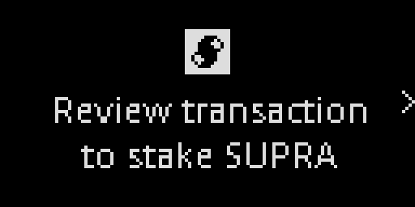
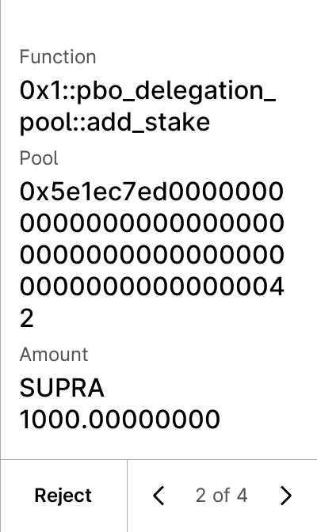
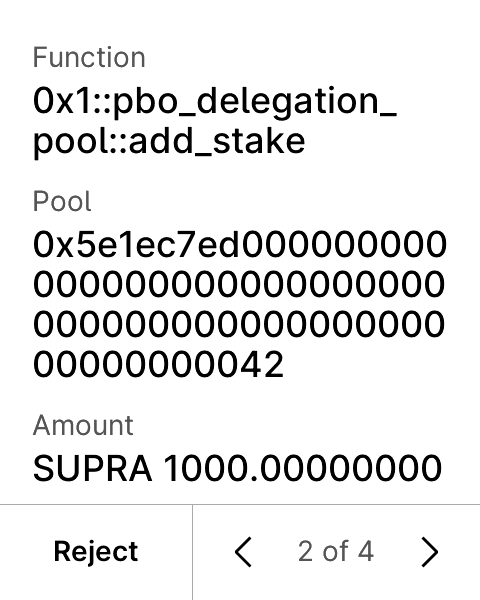
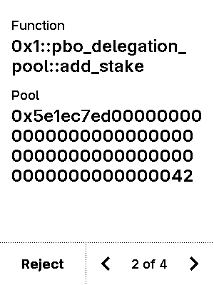

# Supra Ledger app

A Ledger device app for the [Supra L1](https://supra.com) blockchain, brought up to Ledger's current requirements for a listing in Ledger Live.

> **Unofficial.** This project is not affiliated with or endorsed by Supra or the Entropy Foundation. The Supra name and logo belong to their owners.
>
> **Not audited.** No security audit has been done yet.

This repository only presents the project. The source code is kept private for now and is available to the Supra team on request.

## Status

| Area | State |
|---|---|
| Devices | Nano S Plus, Nano X, Stax, Flex, Apex P |
| UI | NBGL use-case API on all devices, info and settings pages per Ledger's design guidelines |
| SDK | Ledger SDK v27.1.7, `Makefile.standard_app`, `lib_standard_app` |
| CI | Ledger's mandatory workflows (build, guidelines enforcer), CodeQL, unit tests, lint, spell check, functional tests, host-library tests against the emulated app: all green except the enforcer's `APP_LOAD_PARAMS` check, which can only pass once the app is registered in Ledger's app database |
| Tests | Ragger functional tests with snapshots of every review screen on all five devices |
| Host library | `hw-app-supra` (TypeScript, any Ledger transport), tested end to end against the app in Speculos, with an integration guide for wallet teams |
| Fuzzing | Transaction-parser fuzzer with ASan/UBSan covering every clear-signed function, about 20 million runs per 2 minutes without findings |
| Static analysis | CodeQL `security-and-quality`: 0 results |

## Features

- **Clear signing** of the framework functions wallets use, checked against the Supra framework as deployed on mainnet:
  - transfers: `supra_account::transfer`, `transfer_coins`, `coin::transfer`
  - batch transfers: `supra_account::batch_transfer`, `batch_transfer_coins`, with every receiver and amount and the total
  - staking with delegation pools: `pbo_delegation_pool::add_stake`, `unlock`, `reactivate_stake`, `withdraw`
  - fungible assets: `primary_fungible_store::transfer`
  - all of these also as **fee payer** and **multi-agent** transactions: the review adds the sender, the co-signers and the fee payer
- **Every transaction review** ends with the maximum gas fee, the expiration time in UTC and, unless it is mainnet, the network (testnet or chain ID)
- **Amounts** in `SUPRA` with 8 decimals, for the coin and for the SUPRA fungible asset (verified on chain); other coins and assets in base units next to their full type
- **Address verification** on the device, in the long form StarKey and Suprascan use
- **Blind-signing setting**, off by default; with it off, the device explains why and offers to open the settings
- **Message signing**: printable text is shown in full, other data only with blind signing and as a hash
- **Path restriction**: only hardened `m/44'/<coin type>'/...` paths (SLIP-10 ed25519)
- **Security fixes** over the upstream app, including stricter detection of the clear-signed framework functions, a length check so no byte is signed without being decoded, key material removed from debug output and checked crypto calls

## Screenshots

| Device | Home | Transfer review | Staking review | Blind-signing warning |
|---|---|---|---|---|
| Nano S Plus |  |  |  |  |
| Nano X |  |  |  |  |
| Stax |  |  |  |  |
| Flex |  |  |  |  |
| Apex P |  |  |  |  |

## For wallets

Wallets talk to the app through `hw-app-supra`:

```ts
const supra = new Supra(transport);
const { address } = await supra.getAddress("m/44'/637'/0'/0'/0'", true);
const { signature } = await supra.signTransaction(path, rawTransactionSigningMessage(bcsRawTransaction));
```

It derives the same addresses as Supra's SDK, signs exactly what Supra's SDKs sign, and reports every device status (rejected, blind signing off, wrong app open) as a typed error. The integration guide covers paths, signing formats, what the device shows, limits and a checklist for wallet teams such as StarKey.

## Road to a listing

Done: development basis, Ledger toolchain, security and signing basics, NBGL UI on all current devices, test coverage, clear signing of transfers, batches, staking, fungible assets, fee payer and multi-agent transactions, host library and integration guide.

Next:
1. Wallet integration (StarKey) and publishing the host library
2. Decimals of further well-known tokens, each verified on chain
3. Security audit and submission to Ledger

## Proof of state

The work shown here corresponds to commit `2b0dba7b26f1d3e91c6e83ccb5e9be4b9ee3b697` of the private repository.

## Contact

Developer: r3new ([renewid on GitHub](https://github.com/renewid))

© 2026 r3new. Text and screenshots in this repository: all rights reserved.
