# Supra Ledger app

A Ledger device app for the [Supra L1](https://supra.com) blockchain, brought up to Ledger's current requirements for a listing in Ledger Live.

> **Unofficial.** This project is not affiliated with or endorsed by Supra or the Entropy Foundation. The Supra name and logo belong to their owners.
>
> **Not audited.** No security audit has been done yet.

This repository only presents the project. The source code is kept private for now and is available to the Supra team on request.

## Status

| Area | State |
|---|---|
| Devices | Nano S Plus, Nano X, Stax, Flex, Apex P |
| UI | NBGL use-case API on all devices, info and settings pages per Ledger's design guidelines |
| SDK | Ledger SDK v27.1.7, `Makefile.standard_app`, `lib_standard_app` |
| CI | Ledger's mandatory workflows (build, guidelines enforcer), CodeQL, unit tests, lint, spell check, functional tests: all green |
| Tests | Ragger functional tests with snapshots of every review screen on all five devices |
| Fuzzing | Transaction-parser fuzzer with ASan/UBSan, 26 million runs without findings |
| Static analysis | CodeQL `security-and-quality`: 0 results |

## Features

- **Clear signing** of `supra_account::transfer` and `coin::transfer`: receiver, amount, coin type and gas fee; amounts in `SUPRA` with 8 decimals
- **Address verification** on the device, in the long form StarKey and Suprascan use
- **Blind-signing setting**, off by default; with it off, the device explains why and offers to open the settings
- **Message signing**: printable text is shown in full, other data only with blind signing and as a hash
- **Path restriction**: only hardened `m/44'/<coin type>'/...` paths (SLIP-10 ed25519)
- **Security fixes** over the upstream app, including stricter detection of the clear-signed framework functions, key material removed from debug output and checked crypto calls

## Screenshots

| Device | Home | Transfer review | Blind-signing warning |
|---|---|---|---|
| Nano S Plus | 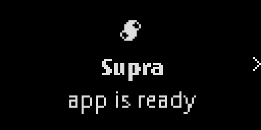 | 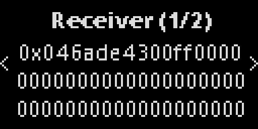 | 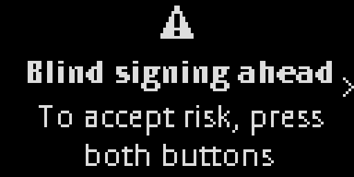 |
| Nano X |  |  |  |
| Stax | 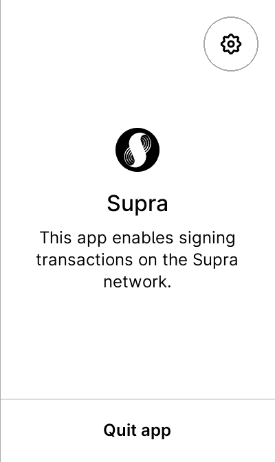 | 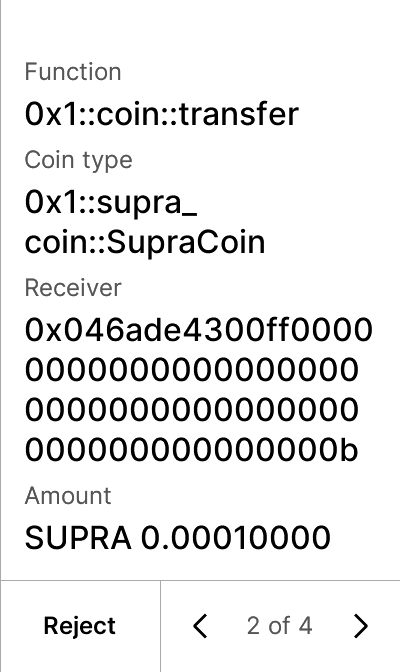 | 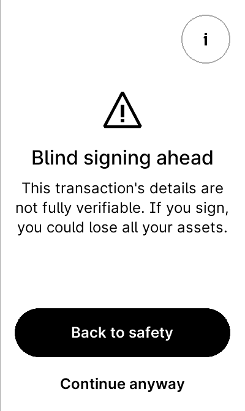 |
| Flex | 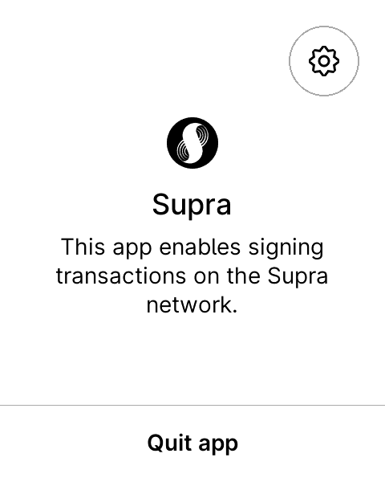 | 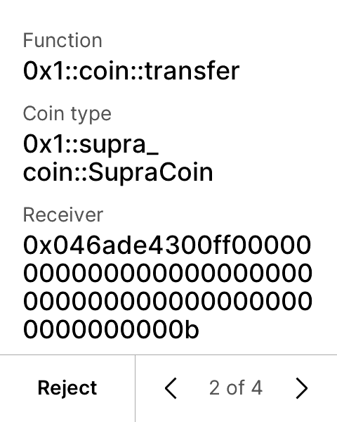 | 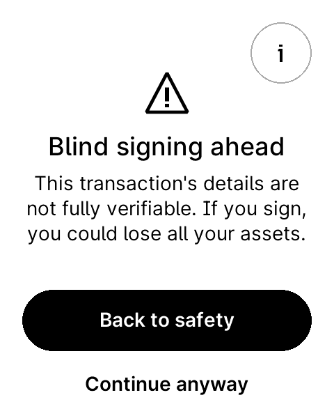 |
| Apex P | 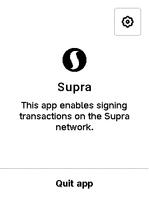 | 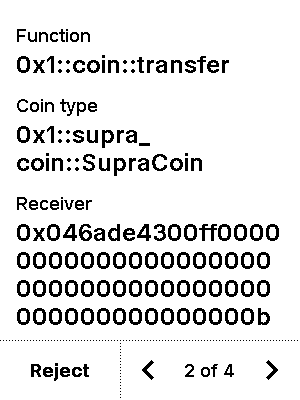 | 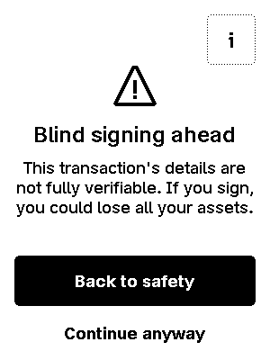 |

## Road to a listing

Done: development basis, Ledger toolchain, security and signing basics, NBGL UI on all current devices, test coverage.

Next:
1. More clear signing (staking/delegation, other coins, fee payer, chain ID and expiration)
2. Host library (`hw-app-supra`, JS/TS) and an integration guide for wallets
3. Security audit and submission to Ledger

## Proof of state

The work shown here corresponds to commit `02c026ccc1984d6451019e48d8b430407387c3ba` of the private repository.

## Contact

Developer: r3new ([renewid on GitHub](https://github.com/renewid))

© 2026 r3new. Text and screenshots in this repository: all rights reserved.
